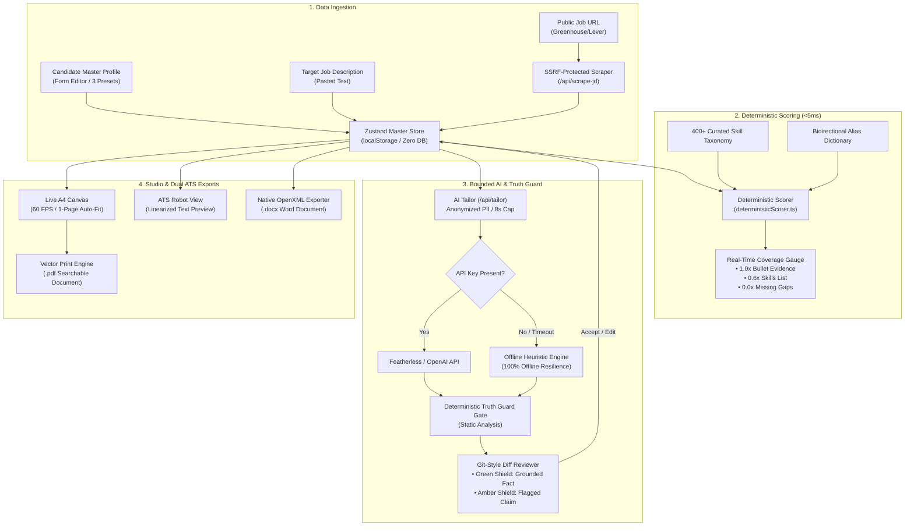

# 🎯 ResuArchitect AI — Interactive ATS Resume Architect & Tailoring Studio

> **CBIT Hacktoberfest '26 — Official Submission Repository**  
> *Chaitanya Bharathi Institute of Technology (CBIT), Hyderabad*

[](https://github.com/cbitosc/HFT26-TEAM-4)
[](https://github.com/cbitosc/HFT26-TEAM-4)
[](LICENSE)
[](docs/ARCHITECTURE.md)

---

## 👥 Official Team Information

| Attribute | Details |
| :--- | :--- |
| **Team Name** | **Red flowers** |
| **Team Number** | `TEAM-4` (`HFT26-TEAM-4`) |
| **Registration ID** | `HFEST26-2P5XJ82R` |
| **Problem Track** | **AI-Powered Resume Architect & Interactive Tailoring Studio** |
| **Domain** | `General Track / AI & Productivity` |
| **Team Leader** | Nawander Raghavendra (`rnn.2777@gmail.com`) — IIIT Hyderabad |
| **Institution** | International Institute of Information Technology, Hyderabad (IIIT-H) |

### 👥 Registered Team Members

| # | Name | Email | Institution |
| :-: | :--- | :--- | :--- |
| 1 | **Nawander Raghavendra** *(Lead)* | `rnn.2777@gmail.com` | IIIT Hyderabad |
| 2 | **Nara Lakshmi Sankeerth** | `raghavendra.nawander@students.iiit.ac.in` | IIIT Hyderabad |
| 3 | **Navneet** | `raghavendranavneetnawander@gmail.com` | IIIT Hyderabad |

---

## 📌 Problem Statement

Over 75% of qualified job seekers are silently filtered out by Applicant Tracking Systems (ATS) like Workday, Taleo, Greenhouse, and Lever before human recruiters ever review their applications. This breakdown happens due to three systemic industry problems:

1. **The Parsing Trap**: Resumes designed on modern drag-and-drop graphic builders use multi-column CSS tables, text frames, floating canvas graphics, and non-standard symbols that turn into unreadable garbage when processed by linear ATS text extractors.
2. **The Keyword Alignment Gap**: Candidates fail to map their authentic achievements to the exact terminology, must-have qualifications, and impact metrics demanded by target Job Descriptions (JDs).
3. **The LLM Hallucination Hazard**: Unconstrained generative AI tools invent past employment metrics (e.g., *"Grew revenue by $10M"*), fabricate technologies the candidate never touched, and compromise candidate privacy by sending personal data to untrusted cloud databases.

---

## 💡 The ResuArchitect AI Solution

**ResuArchitect AI** is an intelligent, **local-first, privacy-preserving resume architecture platform** that bridges the gap between candidate qualifications and target job requirements with zero hallucinations and certified ATS formatting.

- 🔒 **100% Local-First & Zero-DB**: Candidate profile data lives entirely in browser `localStorage`. No candidate PII is sent to external databases or stored without consent.
- ⚡ **Sub-5ms Deterministic Match Scoring**: Evaluates candidate coverage across a built-in taxonomy of **400+ tech skills** with an alias dictionary (`K8s` $\leftrightarrow$ `Kubernetes`, `Postgres` $\leftrightarrow$ `PostgreSQL`) using an empirical weighted evidence formula.
- 🛡️ **Bounded AI Tailor with Algorithmic Truth Guard**: Proposes tailored summary and Google XYZ bullet rewrites, gated by a **deterministic code truth guard** that automatically flags ungrounded tools or fabricated metrics before candidate approval.
- 📄 **Certified Dual ATS Export Engine**: One-click generation of native **OpenXML `.docx`** (authentic `Heading 1`, `Heading 2`, right-aligned tab stops, standard bullet points) and **crisp vector print `.pdf`** (`@page A4`).
- 🤖 **"View as ATS Robot" Inspector**: A real-time diagnostic view that strips all visual styling to show the exact linearized plain-text stream and sequential reading order parsed by ATS robots.
- 🌐 **SSRF-Protected Public Job URL Reader**: Ingests job postings from Greenhouse, Lever, and public career pages with strict SSRF defense (blocking private/localhost IPs, cloud metadata, and DNS rebinding) and clean fallback to manual paste.

---

## 🏗️ System Architecture & Workflow



> 📖 **Deep Dive**: For full schema definitions, mathematical scoring proofs, and security architecture, read [docs/ARCHITECTURE.md](docs/ARCHITECTURE.md).

---

## ✨ Key Features & Technical Highlights

### 1. Split-Screen Interactive Visual Studio
- **Left Pane**: Dynamic studio tabs for Profile Editor, JD & Match Scoring, AI Tailor Diffs, and Theme Customization.
- **Right Pane**: Instant 60 FPS live A4 canvas preview with zoom controls (75% to 120%), theme switching, and instant toggle to **"View as ATS Robot"**.

### 2. 3 Production-Grade Master Presets & Target JDs
- **Alex Rivera**: Senior Full-Stack Engineer paired with an authentic *Stripe Senior Full-Stack Job Description*.
- **Dr. Elena Vance**: Senior Machine Learning Engineer paired with an authentic *Google Staff ML Engineer Job Description*.
- **Marcus Chen**: Senior Technical Product Manager paired with an authentic *Airbnb Platform PM Job Description*.

### 3. Deterministic JD Coverage Matrix
- **Empirical Evidence Formula**: Awards 1.0x credit for skills proven in experience/project bullets, 0.6x credit for skills only listed in skills catalog, and 0.0x for missing gaps.
- **Requirement Tiering**: Classifies requirements into Must-Haves (60% weight) vs. Preferred Qualifications (40% weight).
- **1-Click Skill Injection**: Amber gap badges feature an instant `+ Add to Skills` button that reactively updates the master resume and boosts coverage score in real time.

### 4. Bounded AI Tailor & Algorithmic Truth Guard
- **Zero Hallucination Guarantee**: The deterministic Truth Guard statically inspects every suggested rewrite for ungrounded tools or fabricated metrics not present in the master profile.
- **Git-Style Diff Reviewer**: Side-by-side Before/After diffs with keyword badges, green verified shields, amber verification alerts, inline editing, and bulk *"Accept All Verified"* action.
- **Single-Bullet Google XYZ Co-Pilot**: Integrated `"✨ Optimize"` button on every experience and project bullet, synthesizing Google's formula: *"Accomplished [X], as measured by [Y], by doing [Z]"*.

### 5. Dual ATS Document Generation
- **Native OpenXML `.docx`**: Uses the `docx` library to construct true Word document hierarchies with `HeadingLevel.HEADING_1`, `HeadingLevel.HEADING_2`, right-aligned tab stops for dates, and genuine bullet point runs.
- **Vector Print `.pdf`**: Clean `@page A4` vector output with selectable text and isolated print styling.
- **1-Page Auto-Fit Engine**: Dynamic CSS clamping (`--section-gap`, `--bullet-gap`, and font scale) that automatically constraints content to fit a single page.

### 6. SSRF-Safe Public Job URL Reader
- Scrapes job postings from public URLs (Greenhouse, Lever, etc.) with multi-layer SSRF protection:
  - Whitelists only `http:` and `https:`.
  - Blocks loopback (`127.0.0.0/8`), private subnets (`10.0.0.0/8`, `172.16.0.0/12`, `192.168.0.0/16`), cloud metadata (`169.254.169.254`), and IPv6 loopback (`::1`).
  - Pre-resolves DNS records via `dns.promises.lookup` to prevent DNS rebinding.
  - Enforces a 5-second `AbortController` timeout and a 1MB payload ceiling.
  - Automatically detects anti-bot / login walls (Cloudflare, LinkedIn) and falls back cleanly with clear direct-paste guidance.

---

## 🚀 Local Setup & Installation

Follow these steps to run ResuArchitect AI locally on your development machine:

### Prerequisites
- **Node.js**: `v18.17.0` or higher (Node.js 20+ LTS recommended)
- **npm**: `v9.0.0` or higher
- **Git**: Installed and configured

### 1. Clone the Local Repository
```bash
git clone https://github.com/cbitosc/HFT26-TEAM-4.git
cd HFT26-TEAM-4
git checkout feature/prototype
```

### 2. Install Dependencies
```bash
npm install
```

### 3. Configure Environment (Optional)
ResuArchitect AI includes a built-in **Offline Heuristic Engine** and works **100% offline out-of-the-box** without any API keys. If you wish to connect an external LLM for tailoring:

```bash
cp .env.example .env.local
```

Add your preferred provider credentials to `.env.local`:
```env
# Optional: Featherless or OpenAI API credentials
FEATHERLESS_API_KEY="your-featherless-api-key"
# OR
OPENAI_API_KEY="your-openai-api-key"
```

### 4. Launch the Development Server
```bash
npm run dev
```

Open [http://localhost:3000](http://localhost:3000) in your browser to access the ResuArchitect AI Studio.

### 5. Run the Autonomous Test Suite
Execute the fast automated unit test suite (38 tests across 12 suites):
```bash
npm test
```

### 6. Production Build Verification
Verify type safety and compile the Next.js production build:
```bash
npm run build
```

---

## 🎬 3-Minute Demo Video Walkthrough Script

Use this structured scene-by-scene script when recording your 3-minute hackathon evaluation video:

| Time | Scene | Action & Narration | Key Visual |
| :---: | :--- | :--- | :--- |
| **0:00 - 0:30** | **The ATS Problem & Solution Overview** | *"Recruiters receive hundreds of resumes, but 75% are filtered out by ATS due to parsing glitches and keyword gaps. Meet ResuArchitect AI — a privacy-first, local-first studio that tailors resumes deterministically with zero hallucinations."* | Show Home Studio, split-screen layout, and load preset: **Alex Rivera (Senior SWE)**. |
| **0:30 - 1:00** | **Deterministic Scoring & Gap Engine** | *"Watch the JD Coverage Matrix in action. We select the Stripe Senior Full-Stack JD. In less than 5 milliseconds, our deterministic engine analyzes 400+ tech skills. Notice the circular gauge showing 68% match with weighted evidence. Click '+ Add to Skills' on Kubernetes — the score jumps instantly to 74%."* | Click Stripe preset, inspect Must-Have vs. Preferred badges, and click `+ Add to Skills`. |
| **1:00 - 1:40** | **Bounded AI Tailoring & Truth Guard** | *"Now we navigate to the AI Tailor. Unlike generic chatbots that hallucinate fake metrics, ResuArchitect AI uses an algorithmic Truth Guard. Notice the Git-style Diff Reviewer: verified facts get a green shield, while unverified claims get flagged with an amber warning. We click 'Accept All Verified' — our resume is tailored safely."* | Switch to AI tab, trigger tailor, show Before/After diff card with Green/Amber shields, and accept diffs. |
| **1:40 - 2:10** | **Single-Bullet Google XYZ Co-Pilot** | *"In the Experience tab, click '✨ Optimize' on any bullet. Our co-pilot converts weak bullets into high-impact Google XYZ statements ('Accomplished [X] measured by [Y] by doing [Z]'). The floating Score Delta chip shows real-time progress."* | Click '✨ Optimize', show the comparison modal with target keywords, and apply the optimized bullet. |
| **2:10 - 2:40** | **Visual Studio & ATS Robot View** | *"On the right canvas, customize fonts, scale, and theme: Modern Minimalist, Executive Ivy, or Clean Tech. Toggle '1-Page Auto-Fit' to dynamically clamp margins. Now click 'View as ATS Robot' — see exactly how ATS parsers read your resume in linear order without formatting errors."* | Switch themes, toggle ATS Robot View to show raw text and parser badges. |
| **2:40 - 3:00** | **Dual Export & Wrap-Up** | *"Finally, click Export. ResuArchitect AI exports native OpenXML .docx with authentic Word headings and right-aligned date tabs, plus a selectable vector PDF. 100% local-first, zero DB, zero hallucinations. Built by Team Red flowers for CBIT Hacktoberfest '26."* | Click DOCX export and PDF export, showing generated documents. |

---

## 🧪 Verification & PR Submission Checklist

- [x] **SSRF-Protected URL Scraper**: `POST /api/scrape-jd` blocks localhost, private IPs (`10.0.0.0/8`, `172.16.0.0/12`, `192.168.0.0/16`, `127.0.0.0/8`), cloud metadata (`169.254.169.254`), with 5s timeout and 1MB limit.
- [x] **URL Reader UI Integration**: `JdScoringPanel.tsx` features an "Import from URL" toggle, input box, loading spinner, and graceful fallback to direct pasting.
- [x] **Deterministic Match Scorer**: Evaluates 400+ skill taxonomy and alias dictionary in `<5ms` with 1.0x bullet / 0.6x skills list weighting.
- [x] **Algorithmic Truth Guard**: Gates AI suggestions, blocks fabricated metrics and unverified tools, and presents green/amber badges in `DiffReviewer.tsx`.
- [x] **Dual ATS Exporter**: OpenXML `.docx` with `HeadingLevel.HEADING_1` / `HEADING_2` and browser vector print `.pdf`.
- [x] **Visual Studio**: Split-screen editor, 3 master presets, theme customizer, 1-page auto-fit constraint, and ATS Robot View.
- [x] **Comprehensive Test Suite**: 38 unit tests across 12 suites with 100% pass rate (`npm test`).
- [x] **Clean Production Build**: `npm run build` succeeds with zero TypeScript or ESLint errors.
- [x] **Exhaustive Documentation**: `docs/ARCHITECTURE.md` with system diagrams and `README.md` with team details and demo script.

---

## 📄 License

This project is licensed under the **MIT License** — see the [LICENSE](LICENSE) file for details.

Developed with ❤️ by **Team 4 (Red flowers)** for **CBIT Hacktoberfest '26**.
