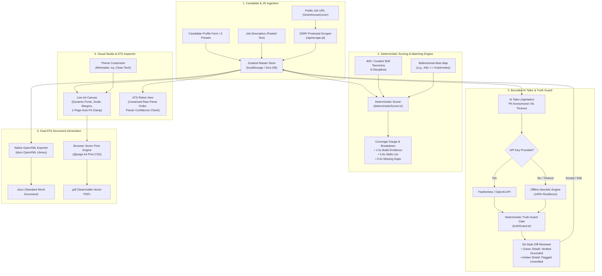
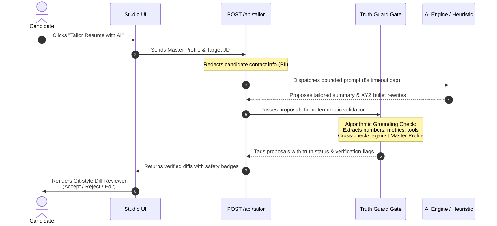
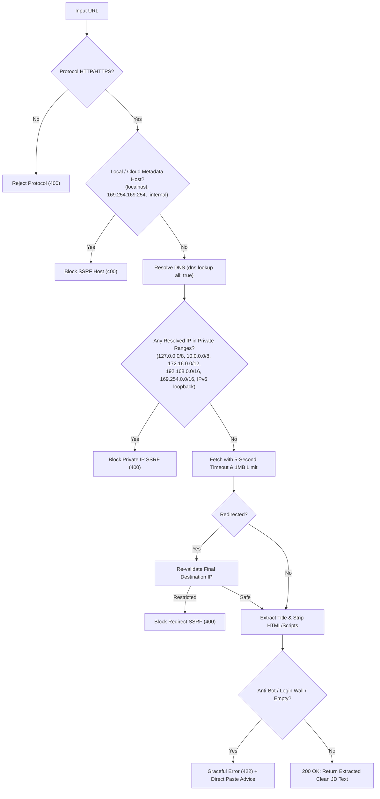

# ResuArchitect AI — System Architecture & Technical Specification

> **Team 4 (Red flowers) — CBIT Hacktoberfest '26**  
> *Autonomous, Privacy-First Resume Architecture & Deterministic ATS Tailoring Studio*

---

## 1. Executive Summary & Design Philosophy

Modern Applicant Tracking Systems (ATS) and hiring teams discard over 75% of qualified resumes due to two distinct failure modes:
1. **Structural & Formatting Failures**: Complex multi-column layouts, canvas drawings, HTML tables, text boxes, and non-standard symbols fail to parse cleanly in legacy ATS parsers (Workday, Taleo, Greenhouse, Lever).
2. **Keyword & Relevance Mismatches**: Candidates fail to align their authentic experience with the specific terminology, must-have skills, and action metrics demanded by target Job Descriptions (JDs).
3. **The AI Hallucination Trap**: Generic LLM resume tools invent unearned credentials, inject fake metrics (e.g., "Increased revenue by $10M"), and expose candidate PII to third-party cloud servers without consent.

**ResuArchitect AI** solves this with a **local-first, deterministic, and bounded AI architecture**. It operates directly in the candidate's browser, evaluates JD coverage in under 5 milliseconds with an extensive 400+ skill taxonomy, enforces a deterministic **Truth Guard** that flags unverified claims before they ever reach an export, and delivers authentic **dual ATS exports** (native OpenXML `.docx` and vector print `.pdf`).

```
                              ┌────────────────────────────────────────┐
                              │            ResuArchitect AI            │
                              │         Architecture Topology          │
                              └──────────────────┬─────────────────────┘
                                                 │
          ┌──────────────────────────────────────┴──────────────────────────────────────┐
          ▼                                                                             ▼
┌─────────────────────────────────┐                                           ┌───────────────────────────────────┐
│     Client Studio Frontend      │                                           │        Bounded Edge Engine        │
│ ─────────────────────────────── │                                           │ ───────────────────────────────── │
│ • Next.js 14 App Router (React) │                                           │ • Deterministic Scorer (<5ms)     │
│ • Zustand + LocalStorage Engine │                                           │ • 400+ Skill Taxonomy & Alias Map │
│ • Split-Screen Visual Editor    │                                           │ • Algorithmic Truth Guard Gate    │
│ • Live A4 Canvas (60 FPS)       │                                           │ • SSRF-Protected Job URL Reader   │
│ • "View as ATS Robot" Inspector │                                           │ • Offline Heuristic AI Tailor     │
│ • Dual Exporters (DOCX & PDF)   │                                           │ • Optional LLM Fallback (8s cap)  │
└─────────────────────────────────┘                                           └───────────────────────────────────┘
```

---

## 2. End-to-End System Architecture

The following diagram illustrates the complete data lifecycle from candidate profile ingestion to dual ATS export:



---

## 3. Data Schemas & State Management

All domain entities are strictly typed and runtime-validated using **Zod** (`src/lib/schema/`).

### 3.1 Resume Document Model (`ResumeDocument`)

```typescript
export interface ResumeDocument {
  id: string;
  basics: {
    name: string;
    label: string;             // e.g. "Senior Full-Stack Engineer"
    email: string;
    phone: string;
    location: string;
    website?: string;
    linkedin?: string;
    github?: string;
    summary: string;
  };
  work: Array<{
    id: string;                // Immutable UUID for bullet tracking
    company: string;
    position: string;
    location?: string;
    startDate: string;
    endDate?: string;
    current: boolean;
    highlights: string[];      // XYZ action bullets
  }>;
  education: Array<{
    id: string;
    institution: string;
    area: string;              // Degree & Major
    studyType?: string;
    startDate?: string;
    endDate?: string;
    score?: string;            // GPA / Honors
  }>;
  projects: Array<{
    id: string;
    name: string;
    description: string;
    highlights: string[];
    keywords: string[];
    url?: string;
  }>;
  skills: Array<{
    id: string;
    category: string;          // e.g. "Languages", "Cloud & DevOps"
    skills: string[];
  }>;
  certifications?: Array<{
    id: string;
    name: string;
    issuer: string;
    date?: string;
  }>;
  sectionOrder: Array<
    "summary" | "work" | "education" | "projects" | "skills" | "certifications"
  >;
  layout: {
    theme: "modern" | "executive" | "tech";
    fontFamily: "inter" | "garamond" | "roboto";
    fontSize: number;          // 9.5pt - 11.5pt
    margins: "compact" | "normal" | "spacious";
    autoFitOnePage: boolean;   // Dynamic section-gap and bullet-gap clamp
  };
}
```

### 3.2 State Architecture & Reactivity

The application state is managed by `useResumeStore` (`src/lib/store/useResumeStore.ts`), built with **Zustand** and `zustand/middleware/persist`:
- **Client-Side Persistence**: State is serialized into browser `localStorage` under key `resuarchitect_storage_v1`. Refreshing or closing the tab preserves candidate progress without any backend database requirement.
- **Granular Actions**: Immutable updates for nested items (`updateBullet`, `addSkillToGroup`, `reorderSections`, `setThemeConfig`).
- **Sample Presets**: One-click switching between 3 production-grade profiles:
  1. *Alex Rivera* — Senior Full-Stack Engineer (TypeScript, React, Node, AWS, PostgreSQL)
  2. *Dr. Elena Vance* — Senior Machine Learning Engineer (PyTorch, LLMs, CUDA, RAG, Kubeflow)
  3. *Marcus Chen* — Senior Technical Product Manager (API Design, Agile, Microservices, SQL)

---

## 4. Deterministic JD Coverage & Matching Engine

Unlike speculative LLM scorers that produce erratic results on identical inputs, ResuArchitect AI features a **100% deterministic scoring engine** (`src/lib/scoring/deterministicScorer.ts`) that executes in **under 5 milliseconds** on any device.

### 4.1 400+ Skill Taxonomy & Alias Normalization

The scoring engine references a curated engineering taxonomy (`src/lib/scoring/skillTaxonomy.ts`) spanning 8 core technical domains:
1. **Frontend**: React, Next.js, Vue, Angular, Svelte, Tailwind CSS, Redux, Webpack, etc.
2. **Backend**: Node.js, Express, Fastify, Django, Spring Boot, Go, Ruby on Rails, NestJS, etc.
3. **Languages**: TypeScript, JavaScript, Python, Go, Rust, Java, C++, C#, Kotlin, Swift, SQL.
4. **Databases**: PostgreSQL, MySQL, MongoDB, Redis, Cassandra, DynamoDB, Elasticsearch, ClickHouse.
5. **Cloud & DevOps**: AWS, GCP, Azure, Docker, Kubernetes, Terraform, CI/CD, GitHub Actions.
6. **AI & Machine Learning**: PyTorch, TensorFlow, LLMs, LangChain, Hugging Face, Transformers, CUDA, RAG.
7. **System Design & Architecture**: Microservices, Event-Driven Architecture, GraphQL, Kafka, REST.
8. **Testing & Tooling**: Vitest, Jest, Playwright, Cypress, Git, Linux, Prometheus, Datadog.

To eliminate false negatives caused by synonymous acronyms, the **Bidirectional Normalization Alias Map** (`src/lib/scoring/aliasMap.ts`) handles common variants:
$$\text{K8s} \leftrightarrow \text{Kubernetes}, \quad \text{JS} \leftrightarrow \text{JavaScript}, \quad \text{TS} \leftrightarrow \text{TypeScript}, \quad \text{Postgres} \leftrightarrow \text{PostgreSQL}$$

### 4.2 Weighted Evidence Scoring Formula

The ATS match score is computed as a weighted ratio of proven candidate skills against target JD requirements:

$$\text{Coverage Score} = \min\left(100, \left\lfloor \frac{\sum_{i=1}^{N} \text{Weight}(k_i)}{\text{Total Required Keywords}} \times 100 \right\rfloor\right)$$

Where $\text{Weight}(k_i)$ is awarded based on empirical evidence hierarchy:
- **1.0x Credit (Bullet Evidence)**: The skill is mentioned in at least one work experience highlight or project bullet point, proving hands-on application.
- **0.6x Credit (Skills List Only)**: The skill is listed in candidate's skills catalog, but lacks experiential bullet context.
- **0.0x Credit (Missing Gap)**: The skill appears in the target JD but is nowhere in the candidate's resume.

### 4.3 Requirement Tiering & Breakdown

The JD parser segregates requirements into:
- **Must-Have Requirements (60% composite weight)**: Extracted from sections titled *"Requirements"*, *"Must Haves"*, *"Qualifications"*, or lines containing *"required"*, *"5+ years"*.
- **Preferred Requirements (40% composite weight)**: Extracted from *"Nice to Have"*, *"Bonus"*, *"Preferred Qualifications"*.

The UI provides instant circular gauges, Must-Have vs. Preferred completion bars, and 1-click **"+ Add to Skills"** buttons to inject verified gaps directly into the candidate profile.

---

## 5. Bounded AI Tailor & Algorithmic Truth Guard

Resume tailoring with unconstrained generative models creates significant risk: models routinely fabricate past employment metrics, hallucinate tools the candidate never touched, or introduce false claims that cause rejection during background checks.

ResuArchitect AI solves this through a **3-stage bounded tailoring pipeline** with an **algorithmic code gate**:



### 5.1 The Truth Guard Algorithm (`src/lib/ai/truthGuard.ts`)

The Truth Guard performs deterministic static analysis on every proposed rewrite before candidate presentation:

1. **Grounded Entity Extraction**:
   - Parses the master profile to construct a whitelist of candidate-attested technologies, normalized tools, numbers, percentages, and dollar amounts.
2. **Ungrounded Tool Detection**:
   - Compares technical terms in proposed rewrites against the candidate's grounded catalog. If a rewrite introduces an ungrounded tool (e.g., claiming "Kubernetes" when candidate only knows "Docker"), it is flagged with `FLAGGED_UNVERIFIED_TOOL`.
3. **Metric & Number Fabrication Detection**:
   - Extracts all numeric tokens, multipliers (e.g., `10x`), percentages (`45%`), latency benchmarks (`12ms`), and monetary values (`$1.2M`). If a proposed rewrite introduces numbers not present in the original bullet, it is flagged with `FLAGGED_FABRICATED_METRIC`.
4. **Candidate Shield Badging**:
   - **Green Shield (`VERIFIED`)**: Fully grounded in master profile facts; safe for 1-click bulk acceptance.
   - **Amber Alert (`FLAGGED_...`)**: Contains unverified claims; candidate is prompted to confirm or edit before accepting.

### 5.2 Offline Heuristic Resilience

If external AI credentials are not provided or if the network request exceeds the strict **8-second timeout**, the system automatically engages `generateHeuristicTailor` (`src/lib/ai/heuristicTailor.ts`). It generates genuine, grounded suggestions based on keyword gap analysis and Google XYZ action verb synthesis without breaking user workflow.

---

## 6. SSRF-Safe Public Job URL Reader

The URL Reader (`src/app/api/scrape-jd/route.ts` & `src/lib/scraper/urlScraper.ts`) allows candidates to import job descriptions directly from public boards (Greenhouse, Lever, public career pages) without exposing the host to Server-Side Request Forgery (SSRF) attacks.



### 6.1 Multi-Layer SSRF Defense Matrix

| Threat Vector | Mitigation Strategy | Implementation |
| :--- | :--- | :--- |
| **Non-HTTP Schemes** | Protocol whitelist | Rejects `file:`, `ftp:`, `javascript:`, `data:` |
| **Localhost & Internal Hosts** | Hostname blacklist | Blocks `localhost`, `*.local`, `*.internal`, `*.lan` |
| **Cloud Instance Metadata** | Link-local IP block | Blocks `169.254.169.254`, `metadata.google.internal` |
| **Private RFC1918 Ranges** | IPv4 subnet check | Blocks `10.0.0.0/8`, `172.16.0.0/12`, `192.168.0.0/16`, `0.0.0.0/8` |
| **IPv6 Tunnel / Loopback** | IPv6 check | Blocks `::1`, `fe80::/10`, `fc00::/7`, `::ffff:0:0/96` |
| **DNS Rebinding Attacks** | Pre-flight DNS resolution | Resolves all addresses via `dns.promises.lookup` before connection |
| **Redirect SSRF** | Post-fetch validation | Inspects `response.url` and re-runs validation against redirect target |
| **Denial of Service (DoS)** | Strict timeout & size cap | 5-second `AbortController` timeout; 1MB response body limit |
| **Anti-Bot Walls (LinkedIn/Cloudflare)** | Heuristic detection | Detects HTTP 401/403/429 and CAPTCHA patterns; falls back cleanly to paste |

---

## 7. Dual ATS Document Generation Pipeline

Resume layout bugs are the #1 cause of ATS parser failures. ResuArchitect AI implements a dual export architecture that generates certified, standard documents.

### 7.1 Native OpenXML DOCX Exporter (`src/lib/export/docxExport.ts`)

Instead of converting HTML to DOCX (which generates bloated, unparseable tables and corrupted formatting), ResuArchitect AI creates native OpenXML `.docx` binaries directly using the `docx` library:
- **Heading Semantics**: Section headers are compiled as true `HeadingLevel.HEADING_1` and `HeadingLevel.HEADING_2` elements, allowing ATS parsers to index sections cleanly.
- **Tab Stop Date Alignment**: Job dates and institution locations use native OpenXML right-aligned tab stops (`TabStopType.RIGHT`, `TabStopPosition.MAX`) rather than invisible tables or repeated spaces.
- **Native Bullet Runs**: Bullet points use OpenXML `bullet: { level: 0 }` lists, preserving text flow and indentation.
- **Font & Spacing Customization**: Respects user's active theme (Modern Minimalist, Executive Ivy, Clean Tech) and point sizes.

### 7.2 Vector PDF Engine (`src/lib/export/pdfExport.ts`)

PDF export uses the browser's native vector print engine:
- Styled with strict `@page { size: A4; margin: 0; }` rules.
- Text remains 100% selectable, searchable, and vector-crisp at any zoom level.
- Non-printable studio controls (navigation bars, diff drawers, buttons) are excluded via `print:hidden` CSS classes.

### 7.3 "View as ATS Robot" Inspector (`src/components/studio/AtsRobotView.tsx`)

To provide candidates complete confidence before applying, the ATS Robot View strips all CSS visual layout and displays the exact **linearized text stream** that an automated parser extracts:
- Shows the exact sequential reading order of sections and bullets.
- Displays parser verification badges: Standard Headings Detected, Email & Phone Isolated, Chronological Order Verified, Selectable Text Stream Certified.

---

## 8. Verification & Test Suite

The codebase enforces strict autonomous verification with **38 automated unit tests** across 12 test suites, executing in under 600ms via `tsx` (`npm test`):

1. **Skill Taxonomy & Catalog (3 tests)**: Verifies 400+ curated skills and 8 engineering disciplines.
2. **Alias Normalization (3 tests)**: Verifies bidirectional mapping and abbreviation expansion.
3. **Deterministic JD Parser (2 tests)**: Verifies requirement tiering (must-have vs. preferred).
4. **Weighted Evidence Scorer (4 tests)**: Verifies 1.0x bullet credit, 0.6x skills list credit, and composite calculations.
5. **Truth Guard Engine (8 tests)**: Verifies grounded extraction, anti-hallucination tool checks, and metric fabrication flagging.
6. **Native OpenXML DOCX Exporter (4 tests)**: Verifies OpenXML document structure, theme styling, and binary buffer generation.
7. **SSRF Protection & IP Validation (8 tests)**: Verifies blocking of loopback, private RFC1918, cloud metadata (169.254.169.254), IPv6, and non-HTTP schemes.
8. **HTML Parser & Job Text Extraction (2 tests)**: Verifies tag stripping, entity decoding, and structure preservation.
9. **Anti-Bot & Wall Detection (3 tests)**: Verifies detection of HTTP 403, Cloudflare, LinkedIn login walls, and empty responses.

Production builds are verified via Next.js compiler (`npm run build`) ensuring zero TypeScript errors, valid serverless routes, and optimized bundle sizes.
